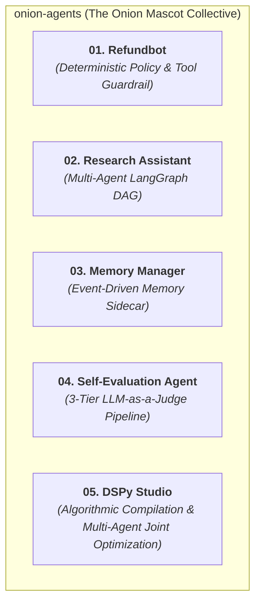

# Onion Agents -- Monorepo Agent Directory

This repository hosts a curated collection of specialized autonomous AI agents implementing different foundational architectural patterns and system paradigms.

---

## 🧅 Agents & Architectural Paradigms

| Paradigm | Agent Kit | Directory | Paradigm | Core Stack | Status |
|---|---|---|---|---|---|
| **01** | **Refundbot** | [`/Refundbot`](./Refundbot) | Policy-governed tool calling & transaction guardrails | Python, FastAPI, SQLite/Postgres | Production Ready |
| **02** | **Research Assistant** | [`/b-research-agent`](./b-research-agent) | Multi-agent DAG (Planner ➔ Research ➔ Writer ➔ Critic ➔ Persist) with voice todo integration | LangGraph, FastAPI, Qdrant, React 18 | Production Ready |
| **03** | **Agent Memory Manager** | [`/agent-memory-manager`](./agent-memory-manager) | Episodic memory companion & failure tracking sidecar | Python, Event-driven Memory Sidecar | Active Development |
| **04** | **Self-Evaluation Agent** | [`/self-evaluation-agent`](./self-evaluation-agent) | 3-tier automated evaluation pipeline (Deterministic ➔ LLM-as-Judge ➔ Human) | Python, Scikit-learn, OpenAI | Production Ready |
| **05** | **DSPy Self-Tuning Agent Studio** | [`/dspy-self-tuning-agent`](./dspy-self-tuning-agent) | Algorithmic prompt compilation, model drift healing & multi-agent pipeline joint optimization | DSPy 3.4.1, Groq, BootstrapFewShot, FastAPI | Production Ready |

---

## 📐 Agent Engineering Standards

Every agent in this repository conforms to the following standards:
1. **Isolated Environments**: Standalone dependencies (`requirements.txt`, `pyproject.toml`, or `package.json`) allowing independent building, testing, and deployment.
2. **Standardized Documentation**:
   - `README.md`: Human-facing overview, visual architecture, and execution guide.
   - `AGENTS.md`: Agent specification, tool contracts, and operational interfaces.
3. **Observability & Evaluation**: Integrated logging, trace collection, quantitative benchmarks, and regression suites.
