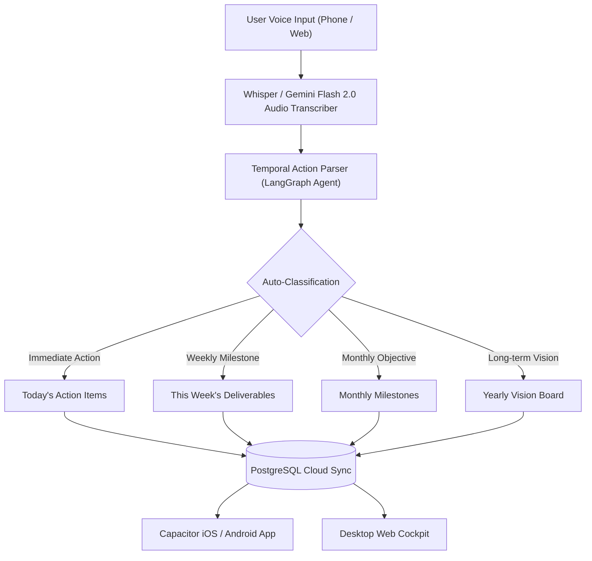

# Market Research & Monetization Strategy: AI Voice Productivity Apps (iOS & Android)

## 1. Executive Summary: The Market Opportunity

The AI productivity and voice-driven software market is experiencing a massive shift in consumer behavior. In 2025–2026, users have grown tired of generic chatbots ("ChatGPT wrappers"). However, they are paying aggressively for **specialized, zero-friction utilities that reduce cognitive overload and solve daily executive dysfunction**.

### The High-Yield Sweet Spot
Building a **Voice-First Life Operating System (Voice Notes + Temporal Goals & To-Dos)** targets the intersection of two of the highest-converting mobile categories:
1. **Voice Capture / Dictation** (e.g., AudioPen, Voicenotes.com) — *High perceived magic, rapid daily habit loop.*
2. **Visual Task & Habit Accountability** (e.g., Structured, Opal, Superlist) — *Highest subscription conversion rates on the App Store.*

---

## 2. Benchmark Case Studies: Who Is Making Money & How

| App / Platform | Platform Focus | Monetization Model | Estimated Revenue / Traction | What Makes Users Pay |
| :--- | :--- | :--- | :--- | :--- |
| **Voicenotes.com** | Web, iOS, Android | $10/mo, $50/yr, $99 Lifetime | **$100K+ MRR** (Indie bootstrap) | Frictionless voice recording &rarr; AI transforms rambles into clean summaries, to-dos, and blog drafts. |
| **AudioPen.ai** | PWA, Web, Mobile | $75/year or $120 2-year pass | **$30K-$50K MRR** (Solo-founder) | Clean, minimalist web/mobile UI that fixes disjointed speech into polished notes. |
| **Structured (App)** | iOS & Android | $2.99/mo, $14.99/yr, $49 Lifetime | **$200K+ / Month** (SensorTower data) | Visual timeline of the day with color-coded blocks. Users pay for visual calm. |
| **Granola / Plaud** | Mac / Mobile / Hardware | $12–$20/mo subscription | High-growth enterprise & indie adoption | Meeting & thought capture without intrusive bots. |
| **Opal / One Sec** | iOS & Android | $9.99/mo or $59.99/yr | **$500K+ / Month** | Dopamine and screen-time reduction. High willingness to pay for personal discipline. |

---

## 3. The Psychology of Payment: Why Users Actually Pay

Users **do not** pay for:
* Generic AI prompts (ChatGPT is free and available everywhere).
* Feature bloat (Notion is free, but too overwhelming for quick capture on the go).

Users **gladly pay** for:
1. **Zero-Latency Capture:** When a thought strikes while walking, driving, or waking up, pulling out the phone and speaking for 30 seconds without formatting or typing.
2. **Automatic Temporal Organization (The 4-Horizon Framework):**
   * **Today:** 3 essential tasks (actionable).
   * **This Week:** Weekly deliverables and habits.
   * **This Month:** 2–3 milestone objectives.
   * **This Year:** Long-term vision and aspirations.
3. **Automated End-of-Day Closure:** The app analyzes what got done, what rolls over to tomorrow, and delivers an evening voice or push summary.
4. **Cross-Platform Omni-Channel Sync:** Capture on iOS/Android while on the go &rarr; sit down at the laptop and have your daily cockpit already structured.

---

## 4. Monetization & Pricing Strategy for Nexus Mind

### Recommended Pricing Tiers (Freemium + Trial)

```
┌────────────────────────────────────────────────────────────────────────┐
│ Free Tier (Acquisition Hook)                                           │
│ • Up to 5 voice notes / day (max 60 seconds each)                      │
│ • Daily & Weekly To-Do boards                                          │
│ • Local storage sync                                                   │
├────────────────────────────────────────────────────────────────────────┤
│ Nexus Pro (The Core Cash Generator)                                    │
│ • $4.99 / week (with 3-day free trial on iOS/Android)                  │
│   OR $39.99 / year (equals ~$3.33/month — high annual lock-in)         │
│ • Unlimited long-form voice dumps (up to 15 min per recording)         │
│ • Full 4-Horizon Goals (Daily, Weekly, Monthly, Yearly Vision)         │
│ • Multi-device cloud sync (Web + iOS + Android via Capacitor)          │
│ • Autonomous evening reflection digest & rollover agent                │
├────────────────────────────────────────────────────────────────────────┤
│ Founder's Lifetime Pass (Web Early Birds)                              │
│ • $79 – $99 One-Time (Limited to first 500 users)                      │
│ • Builds initial cash runway ($10K–$40K upfront capital)               │
└────────────────────────────────────────────────────────────────────────┘
```

---

## 5. Technical Blueprint: React + Capacitor Stack

By wrapping the current **React 19 + Tailwind + FastAPI** stack with **Capacitor**, we achieve **95% code reuse** across:
* **Web:** Desktop browser experience (`localhost:5173` &rarr; custom domain).
* **iOS:** Apple App Store release (TestFlight beta &rarr; App Store).
* **Android:** Google Play Store release.

### Architecture Flow:



---

## 6. Go-To-Market & Growth Playbook (How to Get First 1,000 Users)

1. **"X/Twitter #BuildInPublic" + LinkedIn Video Demos:**
   * Post 30-second screen recordings showing: *"I talked for 45 seconds while walking, and my phone automatically organized my entire week into Today, Week, and Month goals."*
2. **TikTok / Instagram Reels Organic Short-Form:**
   * Content angle: *"How I stopped using complicated Notion templates and switched to a 10-second voice dump every morning."*
3. **Product Hunt & Indie Hackers Launch:**
   * Launch with the Founder's Lifetime Deal ($79). This typically generates $3,000–$15,000 in the first 48 hours for polished AI productivity apps.
4. **App Store Optimization (ASO):**
   * Target high-intent keywords: `Voice Todo`, `Voice Notes AI`, `Daily Planner AI`, `Minimalist Habit Tracker`.
