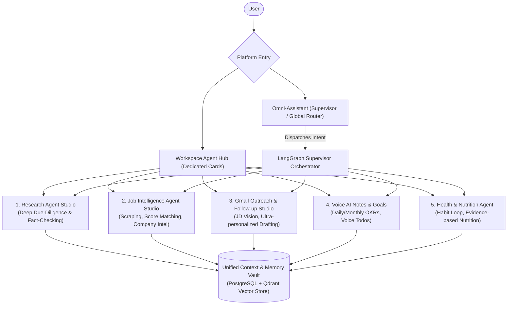

# Autonomous Multi-Agent Productivity OS: Architecture & Implementation Blueprint

## 1. Executive Product Vision

The goal is to evolve the application into a unified **Autonomous Personal Intelligence & Productivity OS**. It combines specialized agent studios with an overarching multi-agent supervisor to handle high-value research, autonomous career workflows, and long-term daily productivity:



---

## 2. Core Architecture: Hybrid Hierarchical Multi-Agent System

### Why Not Pure Separate Agents?
Separate, unlinked agents force users to switch tabs, copy-paste outputs, and duplicate their context (resumes, goals, target companies).

### Why Not a Single Giant Prompt Assistant?
One monolithic model prompt causes prompt drift, token bloat, high cost, and hallucinated tool calls when juggling conflicting tool sets (e.g. scraping vs sending email vs health tracking).

### The Solution: Hierarchical Supervisor + Dedicated Studios
1. **Multimodal Global Assistant Bar:**
   - Accepts **Text**, **Voice/Audio** (Whisper speech-to-text), **Documents** (PDF/DOCX resumes & JDs), and **Images** (LinkedIn screenshots, receipts).
   - Allows explicit selection via **Agent Mode Dropdown** (e.g. "Auto / Supervisor", "Research", "Job Search", "Outreach", "Notes") OR natural conversation where the assistant auto-detects intent.
   - Clarification Loop: If the user's intent is ambiguous, the assistant asks a targeted clarifying question before allocating resources.
2. **Work Allocation & Execution Modes:**
   - **Immediate Execution:** The Supervisor invokes the target LangGraph subgraph (e.g. Research Agent) and streams real-time step markers to the user.
   - **Scheduled & Recurring Jobs:** If the task requires background scheduling (e.g. *"Check LinkedIn for new founding roles every morning at 9 AM"*, or *"Follow up on this outreach email in 5 days if no reply"*), the Supervisor creates a persistent record in the PostgreSQL job queue and assigns the long-running worker.
3. **Dedicated Studios:** Direct interfaces for focused, long-form work (e.g. reviewing research sources, editing outreach drafts, inspecting match matrices).
4. **Unified Context & Vault:** Single source of truth containing:
   - Candidate Resume & Project Artifacts
   - Target Roles, Skills & Preference Matrix
   - Email Tone Profile & Connected Integration Tokens
   - Vectorized Knowledge Base (Qdrant)

---

## 3. High-Retention SaaS UX & Product Principles

To maximize user retention and prevent the "empty dashboard bounce":

```
┌─────────────────────────┐     ┌─────────────────────────┐     ┌─────────────────────────┐
│  1. Low-Friction Auth   │ ──> │   2. Instant Value      │ ──> │ 3. Autonomous Feedback  │
│ Google 1-Click + JWT    │     │ Resume parsed in 5 sec  │     │ Weekly digests, alerts, │
│ Live password validator │     │ Instant match score     │     │ draft approval queues   │
└─────────────────────────┘     └─────────────────────────┘     └─────────────────────────┘
```

1. **Progressive Onboarding:**
   - Rather than 20 mandatory onboarding fields, users drop their resume or LinkedIn profile once.
   - The platform auto-populates skills, experience level, and preferred companies.
2. **Human-in-the-Loop Safeguards for Email & Outreach:**
   - Autonomous drafting with **1-Click Approval Queues**.
   - The agent never fires cold emails into the wild without clear user consent, protecting the user's reputation while saving 90% of manual effort.
3. **Transparent Long-Running Execution:**
   - For background agents (scheduled scrapers, follow-up pingers), display persistent status chips (`Scouting`, `Drafted`, `Awaiting Follow-up`, `Completed`).

---

## 4. Phased Delivery Roadmap

### Phase 1: Authentication & Workspace Multi-Tenancy (Immediate Next Step)
- **Database Layer:** User authentication tables with `bcrypt` password hashing, token revocation, and workspace associations.
- **Backend API Endpoints:**
  - `POST /api/v1/auth/register`: Validation for email format, password strength, duplicate checking.
  - `POST /api/v1/auth/login`: Issue secure JWT access tokens.
  - `POST /api/v1/auth/google`: Google OAuth token verification and account linking.
  - `POST /api/v1/auth/forgot-password` & `POST /api/v1/auth/reset-password`: Tokenized password recovery flow.
  - `GET /api/v1/auth/me`: Protected session validation.
- **Frontend UI:**
  - Modern split-screen layout with visual branding.
  - Interactive eye toggle for password visibility.
  - Live password strength feedback meter (entropy, uppercase, number, symbol requirements).
  - Google OAuth 1-click button integration.
  - Clean forgot/reset password modals.

### Phase 2: Agent Hub Dashboard & Workspace Studio Layout
- Workspace dashboard with dynamic **Agent Cards**:
  - Research Agent Card
  - Job Search & Targeting Agent Card
  - Gmail Outreach & Follow-up Agent Card
  - Upcoming Modules (Voice Notes & Health Tracker)
- Active session history, execution counters, and status badges.
- Global Unified Prompt Bar for cross-agent multi-step commands.

### Phase 3: Autonomous Deep Research Agent (Current LangGraph Core)
- Full 5-stage pipeline: **Planner &rarr; Researcher &rarr; Writer &rarr; Critic &rarr; Persist**.
- Hybrid Qdrant vector retrieval + live DuckDuckGo web search.
- Citation tracking, source transparency, and automated RAGAS quality audits.

### Phase 4: Job Intelligence & Opportunity Agent
- Ingestion of Job Descriptions (raw text, URLs, PDF postings).
- Resume vs. JD ATS match scoring, gap analysis, and tailored skill highlighting.
- Autonomous job scraper & target company tracker with daily/weekly summaries.

### Phase 5: Gmail Outreach & Multimodal JD Vision Agent (Long-Running)
- **Multimodal Input:** Support for screenshot uploads of LinkedIn job posts and emails using Gemini Vision.
- **Hyper-Personalized Drafting:** Generates cold outreach referencing candidate specific projects aligned with company goals.
- **Autonomous Follow-up Loop:** Scheduled weekly follow-up ping engine with response detection (halts follow-up once candidate receives a reply).

### Phase 6: Voice AI Notes & Health Lifestyle Modules
- **Voice AI Notes:** Audio input transcription &rarr; structured daily to-dos, monthly OKRs, and executive summaries.
- **Health & Nutrition Agent:** Real research-backed caloric, macro, and habit tracking from food logs and consumption images.

---

## 5. Technical Stack Architecture

| Layer | Technology | Purpose |
| :--- | :--- | :--- |
| **Frontend** | React 19, TypeScript, Vite, Tailwind CSS, Lucide | Modern, reactive dashboard & auth interfaces |
| **Backend API** | FastAPI, Pydantic v2, Python 3.12 | High-performance asynchronous REST & SSE gateway |
| **Agent Orchestration** | LangGraph, LangChain Core | State graph pipelines, checkpointing & supervisor routing |
| **Vector Database** | Qdrant (v1.12.5 in Podman container) | Dense semantic search & hybrid retrieval |
| **Relational Storage** | PostgreSQL 16 (in Podman container) | User auth, workspaces, session state & long-running jobs |
| **LLM & Vision** | Google Gemini 2.0 Flash / OpenAI GPT-4o | Multi-modal reasoning, synthesis, and vision processing |
| **Embeddings** | Gemini `text-embedding-004` / OpenAI Embeddings | Low-latency cloud vector representations |
